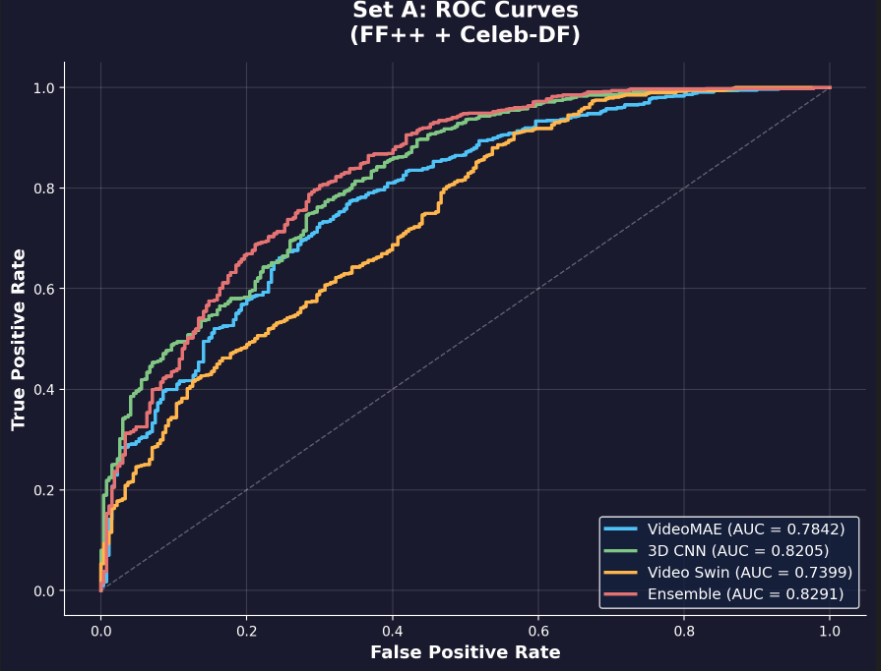

# Video Deepfake Detection System 

A multi-architecture deep learning forensic system for detecting video deepfakes, integrating **VideoMAE v8** (global temporal Vision Transformer) and **R(2+1)D 3D CNN** (local spatial-temporal convolutions) via score-level weighted late fusion, deployed as an interactive **Gradio** web application with **Grad-CAM** Explainable AI (XAI) visualizations.

---

## 🎯 Key Features

- **Dual-Model Ensemble Inference:** Combines **VideoMAE v8** (`weight = 0.6`) and **R(2+1)D 3D CNN** (`weight = 0.4`) via score-level late fusion (`threshold τ = 0.50`) to capture both global temporal motion inconsistencies and localized spatial blending artifacts.
- **Explainable AI (Grad-CAM) & Anatomical Grid Analysis:** Attaches forward/backward hooks to VideoMAE's final encoder layer to generate thermal attention heatmaps and maps high-attention regions across 8 physiological facial zones (forehead, eyes, nose, mouth, cheeks, jawline) into a natural-language forensic report.
- **Visual Diagnostic Charts:** Automatically renders three real-time forensic plots per analysis: **Model Comparison**, **Temporal Segment Analysis**, and **Temporal Consistency (Per-Frame Attention)**.
- **Sliding Window Temporal Segmentation:** Automatically splits videos longer than 7 seconds into overlapping 5-second windows (`stride = 4s`) and aggregates predictions via maximum segment score so localized manipulations are not diluted.
- **Interactive 2-Tab Gradio Web Interface:**
  1. **Deepfake Detection (Single Video & Batch Processing):** Displays verdict (`REAL`/`FAKE`), confidence score, 16-frame preview, Grad-CAM heatmap overlay, diagnostic charts, and bulk multi-video inference with downloadable CSV reports.
  2. **Base Model Comparison:** Live comparison against unmodified Kinetics-400 VideoMAE (`MCG-NJU/videomae-base-finetuned-kinetics`) to demonstrate why domain-specific fine-tuning is essential.
- **4-Layer Security & Validation Guardrails:** Enforces video format/size checks (`.mp4`, `.avi`, `.mov`, `.mkv`, `.webm`, max 500 MB), path-traversal filename sanitization, rolling rate limiting (20 analyses/hour), MediaPipe BlazeFace face presence validation (≥50% across 10 sampled frames), and ambiguous confidence warnings (40%–60%).

---

## 🖥️ System Preview & Explainability (Grad-CAM)


*Full Gradio forensic dashboard showing ensemble prediction (`97.5% Fake Probability`), anatomical Grad-CAM explainability report, 16-frame attention heatmap overlay, and temporal consistency diagnostics.*

## 🏗️ System Architecture & Preprocessing Pipeline

1. **Security & Face Validation:** Validates file format, size, sanitized filename, rate limit, and human face presence using **Google MediaPipe BlazeFace**.
2. **Uniform Frame Sampling:** Extracts 16 evenly spaced frames per segment using `np.linspace()` via OpenCV (`cv2.VideoCapture`).
3. **Face Cropping:** Isolates the largest facial region per frame using OpenCV Haar Cascades with **30% spatial padding** (with full-frame fallback).
4. **Model-Specific Resizing & Normalization:**
   - **VideoMAE v8:** Resized to `224 × 224` (RGB) and normalized via `VideoMAEImageProcessor`.
   - **R(2+1)D 3D CNN:** Resized to `112 × 112` (RGB) and normalized using Kinetics-400 channel statistics (`mean = [0.43216, 0.394666, 0.37645]`, `std = [0.22803, 0.22145, 0.216989]`).
5. **Hybrid Device Execution:** Runs VideoMAE on GPU (CUDA) and R(2+1)D CNN on CPU to prevent VRAM overflow during ensemble inference.

---

## 📊 Experimental Results & Benchmarks

### 1. In-Distribution Evaluation (Set A: FaceForensics++ & Celeb-DF — 945 Test Videos)

Four architectures were trained and benchmarked under controlled conditions (`seed = 42`, 16-frame uniform sampling):

| Model Architecture | Accuracy | Precision | Recall | F1-Score | AUC-ROC |
| :--- | :---: | :---: | :---: | :---: | :---: |
| **VideoMAE** | 76.61% | 76.71% | 96.59% | 85.51% | 0.784 |
| **R(2+1)D 3D CNN** | 80.85% | 81.27% | 95.11% | 87.65% | 0.821 |
| **Video Swin Transformer** | 78.10% | 78.19% | 96.15% | 86.25% | 0.740 |
| **GenConViT VAE** *(Reference)* | 92.49% | 98.55% | 90.81% | 94.53% | — |
| **Ensemble (VideoMAE + 3D CNN)** | **81.06%** | **79.88%** | **98.22%** | **88.11%** | **0.829** |


*ROC curves on Set A (FaceForensics++ & Celeb-DF), showing the late-fusion Ensemble (`AUC = 0.8291`) outperforming every standalone architecture.*

> *Note: GenConViT VAE was excluded from the production late-fusion ensemble due to its incompatible reconstruction-error output scale and sharp accuracy drop on unseen cross-domain datasets.*

### 2. Ablation Study & Production Weight Derivation

- **73-Configuration Grid Search:** Evaluated 2-model and 3-model weight combinations across VideoMAE, R(2+1)D CNN, and Video Swin Transformer. Adding Video Swin provided negligible gain while increasing inference latency, confirming the 2-model ensemble as optimal.
- **Production Ensemble (4-Dataset Retrained Validation):** Achieved **92.00% Accuracy** and **94.81% F1-Score** using `WEIGHT_MAE = 0.6` and `WEIGHT_CNN = 0.4`.

### 3. Cross-Dataset Generalization Gap Analysis (Set B: 912 Unseen Videos)

To measure out-of-distribution robustness without retraining, models trained solely on legacy GAN benchmarks (Set A) were evaluated against modern diffusion and neural-rendering datasets (**DF40** and **DeepFake-Eval-2024**):

| Dataset | Seen in Training? | Ensemble Accuracy | Ensemble F1-Score |
| :--- | :---: | :---: | :---: |
| **FaceForensics++** | Yes | 80.67% | 88.21% |
| **Celeb-DF** | Yes | 86.73% | 90.21% |
| **DF40** | No | 42.86% | 37.78% |
| **DeepFake-Eval-2024** | No | 49.51% | 50.18% |
| **Generalization Gap** | **Seen (83.70%) vs. Unseen (46.19%)** | **-37.51% drop** | — |

---

## 🚀 Quickstart & Local Setup

### 1. Clone & Install Dependencies
```bash
git clone [https://github.com/xinyichiayxl-glitch/video-deepfake-detection-system.git](https://github.com/xinyichiayxl-glitch/video-deepfake-detection-system.git)
cd video-deepfake-detection-system
pip install -r requirements.txt
